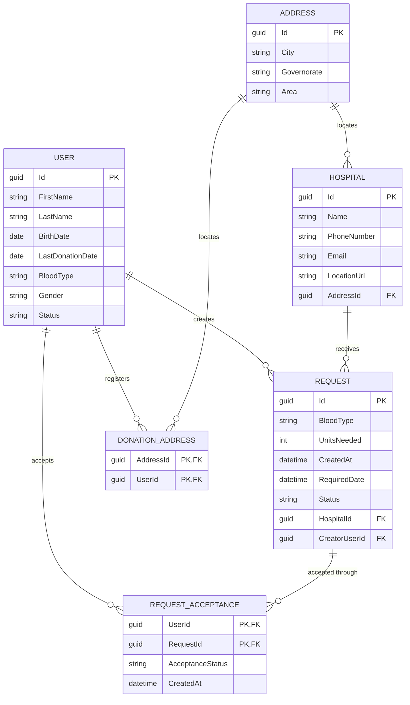

<div align="center">

# Monqiz · منقذ

**A blood donation platform that connects donors, hospitals, and patients.**
منصة تربط المتبرعين بالمستشفيات والمرضى في مكان واحد.

[](https://dotnet.microsoft.com/)
[](https://learn.microsoft.com/aspnet/core)
[](https://learn.microsoft.com/ef/core/)
[](https://www.microsoft.com/sql-server)


</div>

---

## Table of contents

- [Overview](#overview)
- [Tech stack](#tech-stack)
- [Architecture](#architecture)
- [Project structure](#project-structure)
- [Domain model](#domain-model)
- [Getting started](#getting-started)
- [EF Core workflow](#ef-core-workflow)
- [Configuration](#configuration)
- [Roadmap](#roadmap)
- [Contributing](#contributing)

## Overview

**Monqiz** is a backend for managing blood donation requests. Hospitals publish the blood
types and quantities they need, and donors can find the requests closest to them and accept
them. The domain covers donors and their blood types, hospitals and their locations, donation
requests, and the acceptances that connect the two sides.

> **Status:** early development. The solution structure, domain model, EF Core mappings, the
> initial migration, and the API documentation are in place. Authentication and HTTP endpoints
> are the next milestone.

## Tech stack

| Area            | Choice                                          |
| --------------- | ----------------------------------------------- |
| Runtime         | .NET 10 / C# 14                                 |
| API             | ASP.NET Core Web API                            |
| Data access     | EF Core 10 with SQL Server                      |
| Identity        | ASP.NET Core Identity (`Guid` keys)             |
| API docs        | `Microsoft.AspNetCore.OpenApi` + Scalar         |
| Solution format | `.slnx`                                         |

## Architecture

The solution follows a layered structure: the domain sits at the center, business logic lives in
the services layer, and the infrastructure projects provide the database and HTTP adapters.

```
┌─────────────────────────────────────────────────────────────┐
│  src/Monqiz.Api                      host & composition root│
├─────────────────────────────────────────────────────────────┤
│  Infrastructure/Presentation         HTTP controllers        │
│  Core/Services                       business logic          │
│  Infrastructure/Persistence          EF Core, SQL Server     │
├─────────────────────────────────────────────────────────────┤
│  Core/ServicesAbstraction            service contracts       │
│  Core/Domain                         entities & enums        │
│  Shared                              shared types & DTOs     │
└─────────────────────────────────────────────────────────────┘
```

| Project                            | Responsibility                                           | References                          |
| ---------------------------------- | -------------------------------------------------------- | ----------------------------------- |
| `Core/Domain`                      | Entities, enums, and core business rules                 | —                                   |
| `Core/ServicesAbstraction`         | Service interfaces and contracts                         | `Shared`                            |
| `Core/Services`                    | Business logic implementations                           | `Domain`, `ServicesAbstraction`     |
| `Infrastructure/Persistence`       | `DbContext`, entity configurations, and migrations       | `Domain`                            |
| `Infrastructure/Presentation`      | API controllers                                          | `ServicesAbstraction`               |
| `Shared`                           | Shared types and DTOs                                    | —                                   |
| `src/Monqiz.Api`                   | DI, middleware, configuration, and the application host  | `Services`, `Persistence`, `Presentation` |

Dependencies point inward: infrastructure and services depend on the domain, not the other way
around.

## Project structure

```
monqiz/
├── Core/
│   ├── Domain/
│   │   ├── Enums/                    # BloodType, Gender, statuses
│   │   └── Models/                   # User, Hospital, Request, ...
│   ├── ServicesAbstraction/          # service interfaces
│   └── Services/                     # service implementations
├── Infrastructure/
│   ├── Persistence/
│   │   └── Data/
│   │       ├── Configurations/       # EF Core entity configurations
│   │       ├── Migrations/           # EF Core migrations
│   │       └── MonqizDbContext.cs
│   └── Presentation/                 # API controllers
├── Shared/                           # shared types and DTOs
├── src/
│   └── Monqiz.Api/                   # ASP.NET Core host
│       ├── Program.cs
│       └── appsettings.json
├── Monqiz.slnx
└── README.md
```

## Domain model



**Key rules**

- A `User` is an ASP.NET Core Identity user (`IdentityUser<Guid>`) with a blood type, gender,
  status, and optional last donation date.
- A `Request` belongs to exactly one hospital and has one creator.
- `RequestAcceptance` uses a composite key `(UserId, RequestId)`, so a donor can accept the same
  request only once.
- `DonationAddress` is the many-to-many join between donors and addresses.
- Enum values are persisted as strings, which keeps the database readable.

**Enums**

| Enum             | Values                                                                                       |
| ---------------- | -------------------------------------------------------------------------------------------- |
| `BloodType`      | `Unknown`, `A_Positive`, `A_Negative`, `B_Positive`, `B_Negative`, `AB_Positive`, `AB_Negative`, `O_Positive`, `O_Negative` |
| `Gender`         | `Female`, `Male`                                                                             |
| `UserStatus`     | `Inactive`, `Suspended`, `Active`                                                            |
| `RequestStatus`  | `Pending`, `Approved`, `Fulfilled`, `Cancelled`                                               |
| `DonationStatus` | `Pending`, `Accepted`, `Completed`, `Cancelled`                                               |


## EF Core workflow

Run these commands from the repository root:

| Task                        | Command                                                                                                   |
| --------------------------- | --------------------------------------------------------------------------------------------------------- |
| Add a migration             | `dotnet ef migrations add <Name> -p Infrastructure/Persistence -s src/Monqiz.Api`                          |
| Apply migrations            | `dotnet ef database update -p Infrastructure/Persistence -s src/Monqiz.Api`                                |
| Remove the last migration   | `dotnet ef migrations remove -p Infrastructure/Persistence -s src/Monqiz.Api`                              |
| List migrations             | `dotnet ef migrations list -p Infrastructure/Persistence -s src/Monqiz.Api`                                |
| Check for pending changes   | `dotnet ef migrations has-pending-model-changes -p Infrastructure/Persistence -s src/Monqiz.Api`           |

Keep migrations inside `Infrastructure/Persistence` and use the API project as the startup
project.

## Configuration

| Setting                                | Location                                | Notes                                        |
| -------------------------------------- | --------------------------------------- | -------------------------------------------- |
| `ConnectionStrings:DefaultConnection`  | `appsettings.json` / environment        | SQL Server connection string                 |
| `Logging:LogLevel`                     | `appsettings.json`                      | Default and per-category log levels          |
| `AllowedHosts`                         | `appsettings.json`                      | Host filtering                               |

OpenAPI and Scalar are mapped only when `ASPNETCORE_ENVIRONMENT=Development`.

## Roadmap

- [x] Solution skeleton and layer separation
- [x] Domain model and EF Core configurations
- [x] Initial migration
- [x] OpenAPI and Scalar documentation
- [ ] Identity registration and authentication (JWT or cookie-based)
- [ ] Donor and hospital registration flows
- [ ] Donation request endpoints
- [ ] Donor matching by blood type and governorate
- [ ] Acceptance and donation lifecycle
- [ ] Validation, error handling, and ProblemDetails
- [ ] Integration tests
- [ ] Decouple `Domain` from the EF-specific Identity package

## Contributing

1. Create a branch from the current development branch: `feature/<name>` or `fix/<name>`.
2. Build before you push:

   ```bash
   dotnet build Monqiz.slnx
   ```

3. If you change the model, add a migration and make sure the snapshot is in sync:

   ```bash
   dotnet ef migrations has-pending-model-changes -p Infrastructure/Persistence -s src/Monqiz.Api
   ```

4. Keep pull requests focused and describe the **why**, not just the **what**.
