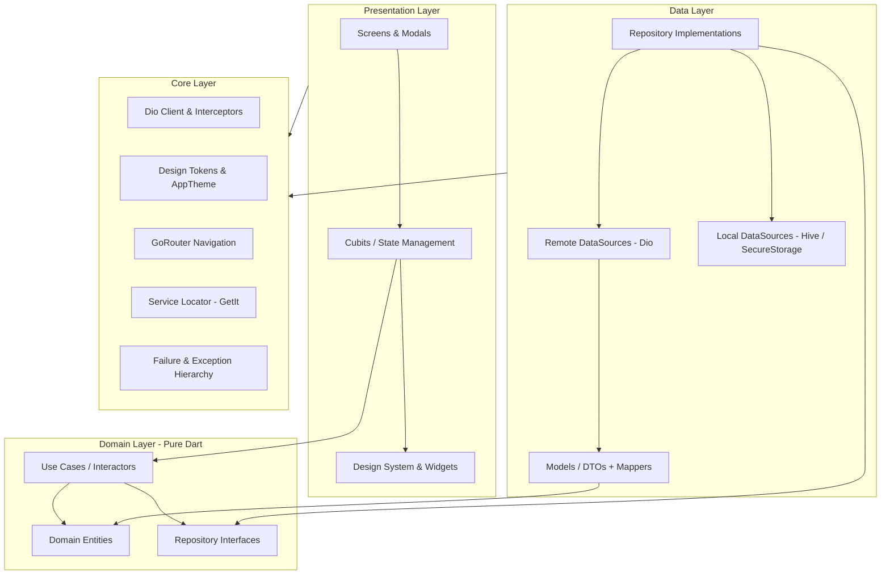

# Monqiz Mobile App: Clean Architecture & Cubit State Management

*   **Author:** Khalid Omr
*   **Status:** Draft
*   **Date:** 2026-11-06

--------------------------------------------------------------------------------

## Overview

Monqiz (منقذ) is an emergency blood donation mobile client engineered with Flutter for Android and iOS. The application directly addresses severe clinical delays in acquiring compatible blood units for critical trauma and surgery cases across Egypt and the MENA region. The mobile client interfaces with an existing .NET 9 Web API backed by a domain schema containing `User`, `Address`, `Hospital`, `Request`, `DonationAddress`, and `RequestAcceptance`.

The system is structured using Layered Clean Architecture (Presentation, Domain, Data, Core) driven by `flutter_bloc` Cubits for predictable, unidirectional state flow. It enforces strict clinical supervision: voluntary donors are connected exclusively to verified, hospital-hosted blood donation requests, eliminating unverified peer-to-peer hazards and black-market risks.

## The Problem

Emergency blood requisition in regional medical centers currently relies on fragmented, chaotic communication channels (e.g., social media posts, group chats). This leads to several systemic failures:
1. **Critical Latency:** Patients and relatives spend hours broadcasting unstructured requests while patients in ICUs require blood within tight windows (often under 3 hours).
2. **Clinical Mismatch:** Untrained donors often respond without knowing compatibility rules, causing wasted trips and rejected donations at the blood bank.
3. **Donor Burnout and Safety Violations:** Lack of centralized tracking leads to repeat donations that violate mandatory physiological recovery intervals (56 days for whole blood, up to 90/120 days depending on donor profile).
4. **Unsupervised Logistics:** Direct peer requests lack validation, exposing vulnerable families to fraudulent intermediaries.

Monqiz solves this by providing a hospital-verified emergency network with automated biological compatibility matching, on-device donor recovery countdowns, and streamlined one-tap pledge commitments.

## Goals

*   **Layered Clean Architecture:** Implement a strictly isolated four-layer design (`core`, `data`, `domain`, `presentation`) in Flutter where business entities and use cases have zero dependencies on Flutter UI frameworks or external network packages.
*   **Reactive Cubit State Management:** Use lightweight, unidirectional Cubits from `flutter_bloc` to govern all operational states (Auth, Case Feed, Emergency Request Creation, Pledge Lifecycle, and Medical Passport).
*   **Hospital-Supervised Case Matching:** Ensure 100% of emergency requests bind to a verified `Hospital` entity with direct GPS routing (`LocationUrl`) and direct contact channels.
*   **Clinical Safety & Eligibility Tracking:** Calculate donor donation readiness on-device based on `User.LastDonationDate`, `Gender`, and `BirthDate`, blocking premature pledges.
*   **Design System Fidelity:** Map all screens 1:1 to the existing `monqiz_app/lib/core/design_system` atomic token library (Cairo/Tajawal typography, RTL Arabic layout, and established blood emergency palettes).

## Non-Goals

*   **In-App Financial Transactions:** Monqiz strictly prohibits monetary compensation or paid donation workflows.
*   **Direct Hospital Management Suite:** Hospital administration, inventory restocking, and hospital staff approvals remain within the .NET Web Portal; the mobile app serves donors and requesters.
*   **Physical Logistics & Delivery:** The app does not manage courier transport or dispatch tracking of blood units between hospitals.
*   **Third-Party Lab Electronic Health Record (EHR) Integration:** Full clinical lab EHR synchronization is out of scope for this version.

## Open Questions

*   **Question 1 (Pledge Verification Mechanism):** Should donation completion (`RequestAcceptance.AcceptanceStatus = Completed`) be confirmed via a one-time numerical token / QR code scanned at the hospital, or can the donor self-report completion subject to backend audit?
*   **Question 2 (Feed Ordering & Distance):** When GPS permissions are denied, should the case feed order strictly by creation date within the user's registered `DonationAddress` governorates, or prioritize units needed?

## Critical User Journeys (CUJs)

### CUJ 1: Voluntary Donor Discovers Case & Pledges Blood
*   **Given**: A registered, authenticated donor who is clinically eligible (last donation > 90 days ago) opens the app in Cairo.
*   **When**: An emergency request matching the donor's blood type (e.g., O-) is posted by Children's Cancer Hospital 57357.
*   **Then**: The donor receives a targeted emergency notification, reviews the `MonqizBloodRequestCard`, verifies the hospital room and needed units, taps "تعهد بالتبرع" (Pledge), and receives navigation routing directly to the hospital blood bank.

### CUJ 2: Patient Relative Creates Emergency Request Under Hospital Supervision
*   **Given**: An authenticated user with an admitted family member in urgent need of 3 units of B+ platelets.
*   **When**: The user opens the emergency request wizard, selects the accredited hospital from the verified directory, inputs required units and urgency timeline, and submits.
*   **Then**: The app validates the hospital link, creates a `Request` entity in `Pending` state, and broadcasts notifications to all compatible donors with matching `DonationAddress` records.

### CUJ 3: Ineligible Donor Checks Medical Passport
*   **Given**: A donor who donated whole blood 3 weeks ago launches the application.
*   **When**: The donor views the home feed or profile.
*   **Then**: The app displays an amber warning banner showing the active rest interval and disables active pledge buttons, preventing unsafe consecutive donations while retaining the ability to share cases.

--------------------------------------------------------------------------------

## Technical Plan (Architecture)

### 1. High-Level Architecture & Layer Dependency Invariant

The mobile client is architected by layer according to Clean Architecture principles. Dependencies point inward strictly toward the Domain layer:



#### Layer Invariants:
1. **Domain Layer**: Contains zero external framework dependencies (pure Dart, no Flutter imports, no Dio, no SharedPreferences). Houses business rules, entity models, and repository contracts.
2. **Data Layer**: Responsible for translating external JSON from the .NET 9 Web API into typed Dart DTOs, mapping them to Domain Entities, and managing cached tokens/data.
3. **Presentation Layer**: Exclusively handles UI rendering, form input capturing, and state-driven widget rebuilds triggered by Cubit state emissions.
4. **Core Layer**: Provides transversal utilities, dependency injection registry (`get_it`), HTTP networking wrapper (`dio`), and the existing atomic design system in `lib/core/design_system`.

---

### 2. Directory Layout by Layer

```text
lib/
├── core/
│   ├── design_system/          # Existing atomic widgets (Buttons, Badges, Cards, etc.)
│   ├── theme/                  # AppColors, AppTypography, AppSpacing, AppTheme
│   ├── error/                  # Failure classes (ServerFailure, CacheFailure, NetworkFailure)
│   ├── network/                # DioClient, Endpoints, AuthInterceptor, ErrorInterceptor
│   ├── storage/                # SecureStorageWrapper (JWT/RefreshToken), PrefsWrapper
│   ├── di/                     # injection_container.dart (GetIt registry)
│   ├── utils/                  # DateFormatter, BloodCompatibilityEngine, EligibilityCalculator
│   └── routing/                # AppRouter (GoRouter setup with auth guard)
│
├── domain/
│   ├── entities/               # UserEntity, BloodRequestEntity, HospitalEntity, AddressEntity, PledgeEntity
│   ├── repositories/           # IAuthRepository, IBloodRequestRepository, IHospitalRepository, IUserRepository
│   └── usecases/
│       ├── auth/               # LoginUseCase, RegisterUseCase, GetSessionUseCase, LogoutUseCase
│       ├── requests/           # GetUrgentRequestsUseCase, CreateRequestUseCase, GetRequestDetailsUseCase
│       ├── pledge/             # PledgeDonationUseCase, UpdatePledgeStatusUseCase, GetMyPledgesUseCase
│       ├── hospitals/          # GetHospitalsUseCase, GetHospitalByIdUseCase
│       └── eligibility/        # CheckDonationEligibilityUseCase
│
├── data/
│   ├── datasources/
│   │   ├── remote/             # AuthRemoteDataSource, RequestRemoteDataSource, HospitalRemoteDataSource
│   │   └── local/              # AuthLocalDataSource (Token cache), FeedLocalCache
│   ├── models/                 # UserModel, BloodRequestModel, HospitalModel, AddressModel, RequestAcceptanceModel
│   │   └── mappers/            # To/From Entity mappers
│   └── repositories/           # AuthRepositoryImpl, BloodRequestRepositoryImpl, HospitalRepositoryImpl, UserRepositoryImpl
│
└── presentation/
    ├── cubits/
    │   ├── auth/               # AuthCubit, AuthState
    │   ├── feed/               # CaseFeedCubit, CaseFeedState (filter by blood type & governorate)
    │   ├── request_details/    # RequestDetailsCubit, RequestDetailsState
    │   ├── create_request/     # CreateRequestCubit, CreateRequestState (wizard step state)
    │   ├── pledge/             # PledgeCubit, PledgeState
    │   ├── passport/           # DonorPassportCubit, DonorPassportState
    │   └── hospitals/          # HospitalDirectoryCubit, HospitalDirectoryState
    └── screens/
        ├── shell/              # MainShellScreen (BottomNavigationBar wrapper)
        ├── auth/               # LoginScreen, RegisterScreen, ForgotPasswordScreen
        ├── home/               # HomeFeedScreen, CaseFilterHeader, EligibilityBannerWidget
        ├── request_details/    # RequestDetailsScreen, PledgeConfirmationBottomSheet
        ├── create_request/     # CreateRequestWizardScreen (Steps: Case Info -> Hospital Selection -> Review)
        ├── passport/           # DonorPassportScreen, DonationHistoryList, EligibilityCountdownWidget
        └── hospitals/          # HospitalsDirectoryScreen, HospitalDetailsScreen
```

---

### 3. Cubit State Management Contracts

Each business domain is driven by an immutable Cubit state machine utilizing sealed classes or pattern matching:

#### CaseFeedCubit State Machine:
*   `CaseFeedInitial`: Initial idle state before data dispatch.
*   `CaseFeedLoading`: Displays skeleton loaders / shimmer matching `MonqizBloodRequestCard`.
*   `CaseFeedLoaded`: Contains:
    *   `List<BloodRequestEntity> requests`
    *   `BloodType? activeBloodFilter` (null = All)
    *   `AddressEntity? activeGovernorateFilter`
    *   `EligibilityResult donorEligibility`
*   `CaseFeedEmpty`: Rendered when no active emergency requests match current filters.
*   `CaseFeedError`: Displays localized error messaging with retry CTA (`MonqizButton`).

#### PledgeCubit State Machine:
*   `PledgeInitial`: No active pledge in progress.
*   `PledgeSubmitting`: Locks pledge button, displays spinning indicator.
*   `PledgeSuccess`: Returns confirmed `RequestAcceptanceEntity`; triggers deep-link intent for `Hospital.LocationUrl` (Google Maps) and displays confirmation modal.
*   `PledgeFailure`: Displays clinical or logistical rejection message (e.g., "Request already fulfilled").

#### CreateRequestCubit State Machine:
*   `CreateRequestState`: Holds form values across 3 steps:
    *   Step 1: Patient details, `BloodType`, `UnitsNeeded`, urgency date (`RequiredDate`).
    *   Step 2: Selected `HospitalId` and department/room information.
    *   Step 3: Verification review and submission status (`isSubmitting`, `submissionError`, `createdRequestId`).

---

### 4. ERD-to-Mobile Domain Mapping

| Backend Model / ERD Entity | Mobile Domain Entity | Mapped Fields / Role in Mobile App |
|---|---|---|
| `User` | `UserEntity` | `id`, `fullName` (`firstName` + `lastName`), `bloodType`, `gender`, `birthDate`, `lastDonationDate`, `phoneNumber`, `pictureUrl`, `status` |
| `Request` | `BloodRequestEntity` | `id`, `hospital` (`HospitalEntity`), `bloodType`, `unitsNeeded`, `unitsPledged`, `requiredDate`, `createdAt`, `status`, `details`, `creatorUserId` |
| `Hospital` | `HospitalEntity` | `id`, `name`, `phoneNumber`, `locationUrl`, `email`, `address` (`AddressEntity`) |
| `Address` | `AddressEntity` | `id`, `governorate`, `city` |
| `DonationAddress` | `DonationAddressEntity` | Links donor profile to multiple preferred notification governorates |
| `RequestAcceptance` | `RequestAcceptanceEntity`| `userId`, `requestId`, `acceptanceStatus` (`Pending`, `Accepted`, `Completed`, `Cancelled`), `createdAt` |

---

### 5. Screen Inventory & Component Binding

1.  **Home Feed (`HomeFeedScreen`):**
    *   *Header:* User profile avatar, current location governorate selector (`MonqizDropdown`).
    *   *Eligibility Banner:* Green badge if eligible (`AppColors.success`), Amber badge with remaining rest days if in recovery interval (`AppColors.warning`).
    *   *Filter Bar:* Horizontal chips (`MonqizChip`) for blood groups (`O-`, `A+`, etc.).
    *   *Feed:* Virtualized `ListView` rendering [`MonqizBloodRequestCard`](file:///d:/My_Projects/monqiz/monqiz_app/lib/core/design_system/cards/monqiz_blood_request_card.dart).
2.  **Request Details & Pledge Sheet (`RequestDetailsScreen`):**
    *   Full clinical breakdown: hospital room, admitting diagnosis details, urgency countdown.
    *   Action footer: Share node button (`MonqizIconButton`), Pledge button (`MonqizButton.primary`).
    *   Modal confirmation creating `RequestAcceptance` and launching external maps navigation.
3.  **Create Request Wizard (`CreateRequestWizardScreen`):**
    *   Multi-stage form using `MonqizTextField` and `MonqizDropdown` validating hospital affiliation and units needed.
4.  **Donor Passport (`DonorPassportScreen`):**
    *   Large digital blood group token (`MonqizBadge`), rest interval circular progress bar (`MonqizProgressBar`), list of completed past donations.
5.  **Hospitals Directory (`HospitalsDirectoryScreen`):**
    *   Filterable directory of accredited hospitals with direct phone dialing (`AppIcons.hotline`) and Google Maps navigation.

--------------------------------------------------------------------------------

## Alternatives Considered

### Alternative A: Feature-First Architecture vs. Layered Clean Architecture

*   **Pros**: Feature-first packaging colocates UI, state, and repositories per vertical slice (e.g., `features/auth/`, `features/feed/`), which can simplify small self-contained modules.
*   **Cons**: Encourages code duplication for deeply shared entities (`Hospital`, `Address`, `BloodType`) and shared caching layers. Makes enforcing strict framework-agnostic domain isolation more difficult across cross-cutting boundaries.
*   **Reason for Rejection**: Rejected by author: Layered Clean Architecture (`core`, `domain`, `data`, `presentation`) was explicitly selected to enforce rigid boundaries where pure Dart entities and use cases remain completely decoupled from presentation and network libraries.

### Alternative B: Full Event-Driven BLoC vs. Functional Cubit

*   **Pros**: Full `Bloc<Event, State>` provides a discrete event stream that can be logged and replayed, useful for complex reactive stream debouncing or event transforms.
*   **Cons**: Adds significant boilerplate requiring separate event classes for straightforward UI mutations (e.g., selecting a blood type filter chip, switching tabs, updating a form field).
*   **Reason for Rejection**: Rejected by author: Cubit provides the exact same stream reactivity, immutability, and state-testability as Bloc while removing event boilerplate. Complex stream debouncing (e.g., clinical search query typing) can be cleanly encapsulated inside Cubit methods.

### Alternative C: Unverified Peer-to-Peer Requests vs. Mandatory Hospital Binding

*   **Pros**: Allows users to post requests immediately without selecting a verified hospital from the database, minimizing initial friction during onboarding.
*   **Cons**: Opens the platform to fraudulent listings, black-market sales, and wasted trips for donors showing up to unverified or nonexistent patients.
*   **Reason for Rejection**: Rejected by author: As reflected in the ERD relationship `Supervision (1 Hospital to N Requests)`, every single blood request must link to an accredited medical center with verified phone and address coordinates to maintain clinical trust and user safety.

--------------------------------------------------------------------------------

## Non-Functional Requirements

*   **Security & Privacy:**
    *   JWT access tokens and refresh tokens must be persisted in encrypted hardware keystore/keychain via `flutter_secure_storage`.
    *   Sensitive patient identity data is anonymized on public emergency cards (`caseId`, room number, and hospital name only; full civilian legal records are never broadcast publicly).
*   **Performance & Latency:**
    *   Case feed must load initial 20 cards in $< 800\text{ ms}$ on 4G networks.
    *   Feed lists must use virtualized builders (`ListView.builder`) with explicit item extents or cached card constraints to sustain 60–120 FPS scrolling without jank.
*   **Offline Tolerance:**
    *   Hospital emergency directory, emergency hotlines (19888), and cached active pledged cases must remain readable from local disk storage when mobile connectivity drops.

--------------------------------------------------------------------------------

## Detailed Implementation Plan

### Target Files to Create/Modify

#### 1. Configuration & Dependencies
*   `monqiz_app/pubspec.yaml` (Modify)
    *   **Scope:** Dependency management.
    *   **Rationale:** Add production dependencies: `flutter_bloc` (Cubit state flow), `dio` (HTTP client), `get_it` (service locator DI), `go_router` (declarative routing & guards), `equatable` (value equality for states & entities), `flutter_secure_storage` (token vault), and `intl` (Arabic date/time formatting).

#### 2. Core Layer (`lib/core/`)
*   `lib/core/error/failures.dart` (Create)
    *   **Scope:** Base `Failure` class and sub-failures (`ServerFailure`, `CacheFailure`, `NetworkFailure`, `EligibilityFailure`).
    *   **Rationale:** Standardized domain failure representations returned via `Result`/`Either` pattern.
*   `lib/core/error/exceptions.dart` (Create)
    *   **Scope:** Infrastructure exceptions (`ServerException`, `CacheException`, `UnauthorizedException`).
    *   **Rationale:** Thrown by data sources and intercepted before crossing the domain boundary.
*   `lib/core/network/dio_client.dart` (Create)
    *   **Scope:** Configured `Dio` singleton with base URL, timeout limits (15s), and interceptor registration.
    *   **Rationale:** Uniform network transport for all .NET API endpoints.
*   `lib/core/network/interceptors/auth_interceptor.dart` (Create)
    *   **Scope:** Attaches `Bearer <token>` to requests and intercepts 401s for token refresh routines.
    *   **Rationale:** Seamless identity maintenance without UI interruption.
*   `lib/core/di/injection_container.dart` (Create)
    *   **Scope:** `GetIt` registry initializing singletons (Dio, SecureStorage) and factories (Cubits, UseCases, Repositories).
    *   **Rationale:** Decoupled instantiation across all layers.
*   `lib/core/utils/eligibility_calculator.dart` (Create)
    *   **Scope:** Pure clinical helper computing days since `lastDonationDate`, gender recovery constraints (90 vs. 120 days), and minimum age (18).
    *   **Rationale:** Centralized safety enforcement preventing invalid pledges across the entire app.
*   `lib/core/routing/app_router.dart` (Create)
    *   **Scope:** `GoRouter` declarative configuration with `ShellRoute` for bottom navigation bar and route guards.
    *   **Rationale:** Unifies deep links, notification intents, and tab switching.

#### 3. Domain Layer (`lib/domain/`)
*   `lib/domain/entities/user_entity.dart` (Create)
    *   **Scope:** Pure Dart entity holding donor profile (`id`, `firstName`, `lastName`, `bloodType`, `gender`, `birthDate`, `lastDonationDate`, `status`).
    *   **Rationale:** Core identity abstraction without database or JSON baggage.
*   `lib/domain/entities/blood_request_entity.dart` (Create)
    *   **Scope:** Pure Dart entity modeling emergency cases (`id`, `hospital`, `bloodType`, `unitsNeeded`, `unitsPledged`, `requiredDate`, `status`, `details`).
    *   **Rationale:** Core domain model feeding discovery and pledges.
*   `lib/domain/entities/hospital_entity.dart` (Create)
    *   **Scope:** Entity holding `id`, `name`, `phoneNumber`, `locationUrl`, `email`, and `address`.
    *   **Rationale:** Represents accredited medical center anchors.
*   `lib/domain/entities/request_acceptance_entity.dart` (Create)
    *   **Scope:** Entity modeling the pledge commitment (`userId`, `requestId`, `status`, `createdAt`).
    *   **Rationale:** Tracks donor fulfillment journey.
*   `lib/domain/repositories/auth_repository.dart` (Create)
    *   **Scope:** Abstract interface: `login()`, `register()`, `getCurrentUser()`, `logout()`.
    *   **Rationale:** Inversion of control contract for user authentication.
*   `lib/domain/repositories/blood_request_repository.dart` (Create)
    *   **Scope:** Abstract interface: `getUrgentRequests()`, `getRequestById()`, `createRequest()`, `pledgeRequest()`, `getMyPledges()`.
    *   **Rationale:** Inversion of control contract for all emergency case operations.
*   `lib/domain/repositories/hospital_repository.dart` (Create)
    *   **Scope:** Abstract interface: `getHospitals()`, `getHospitalById()`.
    *   **Rationale:** Contract for querying medical centers.
*   `lib/domain/usecases/requests/get_urgent_requests_usecase.dart` (Create)
    *   **Scope:** Callable use case fetching filtered requests.
    *   **Rationale:** Encapsulates business logic for feed retrieval.
*   `lib/domain/usecases/pledge/pledge_blood_donation_usecase.dart` (Create)
    *   **Scope:** Callable use case verifying donor eligibility before dispatching `RequestAcceptance`.
    *   **Rationale:** Enforces medical safety rules prior to API submission.

#### 4. Data Layer (`lib/data/`)
*   `lib/data/models/user_model.dart` (Create)
    *   **Scope:** DTO with `fromJson`, `toJson`, and `toEntity()` matching .NET Identity schema.
    *   **Rationale:** Serialization bridge between JSON and `UserEntity`.
*   `lib/data/models/blood_request_model.dart` (Create)
    *   **Scope:** DTO parsing API `Request` entities and nested `Hospital` objects.
    *   **Rationale:** Serialization bridge for emergency cases.
*   `lib/data/models/hospital_model.dart` (Create)
    *   **Scope:** DTO for hospital objects and Google Maps location URLs.
    *   **Rationale:** Serialization bridge for accredited hospital data.
*   `lib/data/datasources/remote/blood_request_remote_data_source.dart` (Create)
    *   **Scope:** Makes HTTP calls to `/api/requests`, `/api/requests/{id}/pledge`, etc.
    *   **Rationale:** Low-level REST API consumer using Dio.
*   `lib/data/repositories/blood_request_repository_impl.dart` (Create)
    *   **Scope:** Implements `IBloodRequestRepository`, handles network error mapping to `Failures`.
    *   **Rationale:** Concrete repository implementation.

#### 5. Presentation Layer (`lib/presentation/`)
*   `lib/presentation/cubits/feed/case_feed_cubit.dart` & `case_feed_state.dart` (Create)
    *   **Scope:** State machine managing case loading, blood group chip filtering, and refresh.
    *   **Rationale:** Drives `HomeFeedScreen` reactively without boilerplate.
*   `lib/presentation/cubits/pledge/pledge_cubit.dart` & `pledge_state.dart` (Create)
    *   **Scope:** State machine managing pledge button actions, confirmation modals, and map launch intents.
    *   **Rationale:** Drives one-tap pledge workflow.
*   `lib/presentation/cubits/create_request/create_request_cubit.dart` & `create_request_state.dart` (Create)
    *   **Scope:** Form state holder validating hospital selection, required date, and units needed.
    *   **Rationale:** Drives `CreateRequestWizardScreen`.
*   `lib/presentation/cubits/passport/donor_passport_cubit.dart` & `donor_passport_state.dart` (Create)
    *   **Scope:** Manages donor history, badge calculations, and countdown timers.
    *   **Rationale:** Drives `DonorPassportScreen`.
*   `lib/presentation/screens/shell/main_shell_screen.dart` (Create)
    *   **Scope:** Scaffolds bottom navigation bar with RTL layout, badge indicators, and 4 root tabs.
    *   **Rationale:** Primary visual navigation frame.
*   `lib/presentation/screens/home/home_feed_screen.dart` (Create)
    *   **Scope:** Renders emergency header, `MonqizBloodRequestCard` list, and filter chips.
    *   **Rationale:** Core discovery dashboard for donors.
*   `lib/presentation/screens/request_details/request_details_screen.dart` (Create)
    *   **Scope:** Detailed view of patient room, hospital phone CTA, and pledge bottom sheet.
    *   **Rationale:** Deep-dive case screen.
*   `lib/presentation/screens/create_request/create_request_wizard_screen.dart` (Create)
    *   **Scope:** 3-step wizard with `MonqizTextField` and `MonqizDropdown` for posting requests.
    *   **Rationale:** Requisition form for patients/relatives.
*   `lib/presentation/screens/passport/donor_passport_screen.dart` (Create)
    *   **Scope:** Digital donor card with eligibility status, past donation list, and statistics.
    *   **Rationale:** Motivational and medical passport hub for donors.
*   `lib/presentation/screens/hospitals/hospitals_directory_screen.dart` (Create)
    *   **Scope:** Searchable directory of hospitals with quick call and navigation triggers.
    *   **Rationale:** Hospital directory interface.
*   `lib/main.dart` (Modify)
    *   **Scope:** App bootstrap.
    *   **Rationale:** Initializes `injection_container`, wraps app in `AppTheme.lightTheme` with Arabic RTL `Directionality`, and binds `AppRouter`.

---

### Verification Plan

#### 1. Automated Unit & Logic Tests
*   `test/core/utils/eligibility_calculator_test.dart`:
    *   Verify male donor (< 90 days) returns `isEligible = false` with correct remaining days.
    *   Verify male donor (>= 90 days) returns `isEligible = true`.
    *   Verify donor under 18 years returns `isEligible = false`.
*   `test/domain/usecases/pledge_blood_donation_usecase_test.dart`:
    *   Verify usecase blocks pledge call to repository if eligibility check fails.
    *   Verify usecase calls repository and returns `Right(RequestAcceptance)` when eligible.

#### 2. Cubit State Tests (`bloc_test`)
*   `test/presentation/cubits/case_feed_cubit_test.dart`:
    *   Test state emission order: `[CaseFeedLoading, CaseFeedLoaded]` on successful fetch.
    *   Test state emission: `[CaseFeedLoading, CaseFeedError]` on repository failure.
    *   Test filtering emits `CaseFeedLoaded` with filtered subset when blood type chip is selected.
*   `test/presentation/cubits/pledge_cubit_test.dart`:
    *   Test emission: `[PledgeSubmitting, PledgeSuccess]` when pledge is confirmed.

#### 3. Widget & Integration Smoke Tests
*   `test/presentation/screens/home_feed_screen_test.dart`:
    *   Pump `HomeFeedScreen` with mocked `CaseFeedCubit` in `CaseFeedLoaded` state.
    *   Verify `MonqizBloodRequestCard` renders with hospital name, units needed progress bar, and "تعهد بالتبرع" CTA.
    *   Verify tapping blood group chip calls `filterByBloodType()`.
*   Static analysis command:
    ```bash
    flutter analyze
    ```
*   Test execution command:
    ```bash
    flutter test
    ```
